# Regulatory Scenarios

Thirteen scenarios covering the WADA Code and GDPR paths the framework automates.

**Each diagram is a transcription of transactions that actually committed.** The
scenarios are executed against the running network by
[scenarios/run.ts](../scenarios/run.ts), which asserts the expected outcome of each
and fails the run if any assertion does not hold. The observed outcome is quoted
beneath every diagram, and the whole document is regenerated by
[scripts/gen-scenarios-doc.py](../scripts/gen-scenarios-doc.py).

Last executed: `2026-08-04T21:56:10.463Z` — **13/13 scenarios passed**.

Rendered copies of every diagram are exported to [diagrams/](diagrams/) as PNG
at 3x scale, suitable for dropping into the manuscript.

```bash
./scripts/network-up.sh && ./scripts/deploy-chaincode.sh
docker compose up -d gateway web
(cd scenarios && npm install && npm start)
python scripts/gen-scenarios-doc.py
python scripts/export-diagrams.py          # -> diagrams/*.png
```

## Index

| # | Scenario | Regulation | Table 2 rule | Result |
| --- | --- | --- | --- | --- |
| S1 | [Adverse analytical finding confirmed on a verified custody chain](#s1) | WADA Art. 5.3, 5.4, 2.1, 7.1, 7.3 | `R1_AAF_CONFIRMED` | pass |
| S2 | [Incomplete chain of custody invalidates the process before any finding](#s2) | WADA Art. 5.4 (guard on Art. 7.1) | `R5_PROCESS_INVALIDATED` | pass |
| S3 | [Pending laboratory accreditation suspends automation pending human review](#s3) | WADA Art. 7.1 / GDPR Art. 22 | `R2_AAF_PENDING_REVIEW` | pass |
| S4 | [Result from a non-accredited laboratory is rejected and audited](#s4) | WADA Art. 6.1 — case absent from the decision table as originally specified | `R2B_ANALYSIS_REJECTED` | pass |
| S5 | [Third ledger-verified whereabouts failure inside 12 months is an ADRV](#s5) | WADA Art. 2.4 / 7.1 | `R4_WHEREABOUTS_ADRV` | pass |
| S6 | [Athlete Biological Passport anomaly escalates to the expert panel](#s6) | ABP / GDPR Art. 22 | `R3_ABP_ALERT_INITIATED` | pass |
| S7 | [Insider acting alone cannot alter committed results-management state](#s7) | §4.1 threat model — insider collusion across CA boundaries | — | pass |
| S8 | [Career-affecting decision blocked until a named human upholds it](#s8) | WADA Art. 7.9 / GDPR Art. 22 | — | pass |
| S9 | [Purpose limitation releases two of six categories to an authorized researcher](#s9) | GDPR Art. 5(1)(c), 7, 9, 25 — §3.5 worked scenario | — | pass |
| S10 | [Consent withdrawal takes effect immediately](#s10) | GDPR Art. 7(3) | — | pass |
| S11 | [Off-chain storage, key revocation with 2-of-3 recovery, then irreversible erasure](#s11) | GDPR Art. 17 | — | pass |
| S12 | [Results are confidential during results management](#s12) | WADA Art. 14.1 | — | pass |
| S13 | [Late custody handover raises an exception and invalidates the process](#s13) | WADA Art. 5.4 | `R5_PROCESS_INVALIDATED` | pass |

### Coverage of the Table 2 decision space

The five published rows of Table 2, the rule added to close the gap found during
implementation, and the precedence guard are each exercised by a scenario:

| Rule | Meaning | Scenario |
| --- | --- | --- |
| `R5_PROCESS_INVALIDATED` | guard — unverified custody chain | S2, S13 |
| `R1_AAF_CONFIRMED` | adverse finding at an accredited laboratory | S1 |
| `R2_AAF_PENDING_REVIEW` | accreditation pending | S3 |
| `R2B_ANALYSIS_REJECTED` | accreditation unverified (gap closed) | S4 |
| `R3_ABP_ALERT_INITIATED` | passport anomaly + expert panel | S6 |
| `R4_WHEREABOUTS_ADRV` | third verified failure in 12 months | S5 |

---

## S1 — Adverse analytical finding confirmed on a verified custody chain

**Regulation:** WADA Art. 5.3, 5.4, 2.1, 7.1, 7.3  
**Decision-table rule:** `R1_AAF_CONFIRMED`  
**Status:** executed and asserted

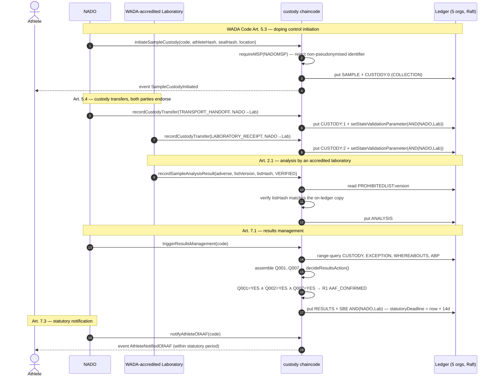

[PNG](diagrams/S1-aaf-confirmed.png) &middot; rendered at 3x for print use

**Observed on the network**

> AAF_CONFIRMED (R1_AAF_CONFIRMED); Art. 7.3 clock started, notified within period: true

<details><summary>Executed steps</summary>

| Actor | Action | Outcome |
| --- | --- | --- |
| NADO | initiateSampleCustody (Art. 5.3) | sample opened, athlete notified |
| NADO → Lab | recordCustodyTransfer ×2 (Art. 5.4) | dual-endorsed, key bound to both organizations |
| Laboratory | recordSampleAnalysisResult (Art. 2.1) | adverse; Prohibited List hash verified |
| NADO | triggerResultsManagement (Art. 7.1) | Table 2 → AAF_CONFIRMED |
| NADO → Athlete | notifyAthleteOfAAF (Art. 7.3) | statutory deadline 2026-08-18T21:53:47.120Z |

</details>

---

## S2 — Incomplete chain of custody invalidates the process before any finding

**Regulation:** WADA Art. 5.4 (guard on Art. 7.1)  
**Decision-table rule:** `R5_PROCESS_INVALIDATED`  
**Status:** executed and asserted

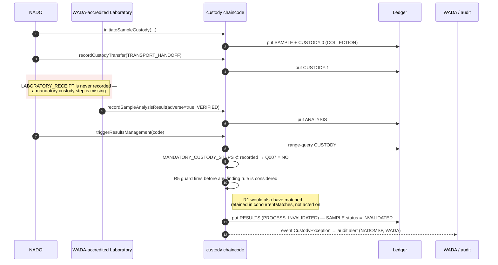

[PNG](diagrams/S2-process-invalidated-incomplete-custody.png) &middot; rendered at 3x for print use

**Observed on the network**

> PROCESS_INVALIDATED (R5_PROCESS_INVALIDATED); sample status INVALIDATED; audit alert to NADOMSP, WADA

<details><summary>Executed steps</summary>

| Actor | Action | Outcome |
| --- | --- | --- |
| NADO | initiateSampleCustody (Art. 5.3) | sample opened |
| NADO → Lab | recordCustodyTransfer (TRANSPORT_HANDOFF) | recorded; LABORATORY_RECEIPT never arrives |
| Laboratory | recordSampleAnalysisResult (Art. 2.1) | adverse result committed |
| NADO | triggerResultsManagement (Art. 7.1) | Q007 = NO → PROCESS_INVALIDATED |
| System → NADO, WADA | raiseAuditAlert | alert to NADOMSP, WADA |

</details>

---

## S3 — Pending laboratory accreditation suspends automation pending human review

**Regulation:** WADA Art. 7.1 / GDPR Art. 22  
**Decision-table rule:** `R2_AAF_PENDING_REVIEW`  
**Status:** executed and asserted

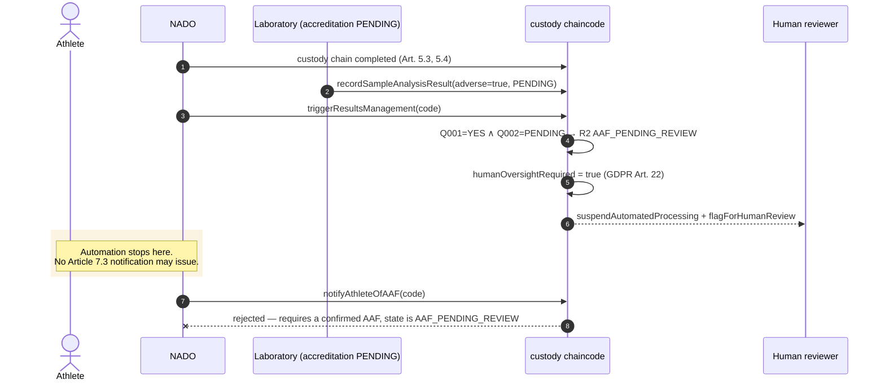

[PNG](diagrams/S3-aaf-pending-review.png) &middot; rendered at 3x for print use

**Observed on the network**

> AAF_PENDING_REVIEW (R2_AAF_PENDING_REVIEW); humanOversightRequired=true; Art. 7.3 notification refused with HTTP 400

<details><summary>Executed steps</summary>

| Actor | Action | Outcome |
| --- | --- | --- |
| NADO / Lab | custody chain completed, analysis committed | adverse; accreditation PENDING |
| NADO | triggerResultsManagement (Art. 7.1) | Q002 = PENDING → AAF_PENDING_REVIEW |
| System | suspendAutomatedProcessing + flagForHumanReview | automated processing halted (GDPR Art. 22) |
| NADO | notifyAthleteOfAAF attempted | refused — HTTP 400 |

</details>

---

## S4 — Result from a non-accredited laboratory is rejected and audited

**Regulation:** WADA Art. 6.1 — case absent from the decision table as originally specified  
**Decision-table rule:** `R2B_ANALYSIS_REJECTED`  
**Status:** executed and asserted

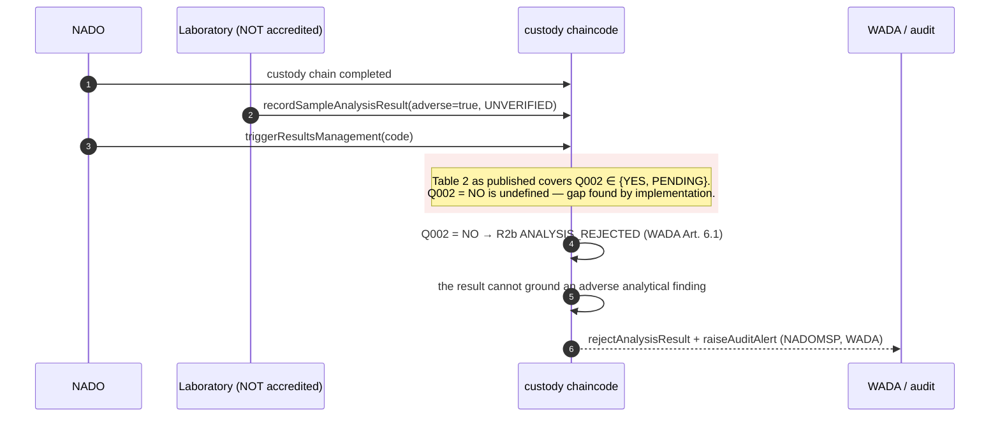

[PNG](diagrams/S4-analysis-rejected-unaccredited-lab.png) &middot; rendered at 3x for print use

**Observed on the network**

> ANALYSIS_REJECTED (R2B_ANALYSIS_REJECTED); audit alert to NADOMSP, WADA

<details><summary>Executed steps</summary>

| Actor | Action | Outcome |
| --- | --- | --- |
| NADO / Lab | custody chain completed, analysis committed | adverse; accreditation UNVERIFIED |
| NADO | triggerResultsManagement (Art. 7.1) | Q002 = NO → ANALYSIS_REJECTED |
| System → NADO, WADA | rejectAnalysisResult + raiseAuditAlert | Art. 6.1: analysis cannot ground a finding |

</details>

---

## S5 — Third ledger-verified whereabouts failure inside 12 months is an ADRV

**Regulation:** WADA Art. 2.4 / 7.1  
**Decision-table rule:** `R4_WHEREABOUTS_ADRV`  
**Status:** executed and asserted

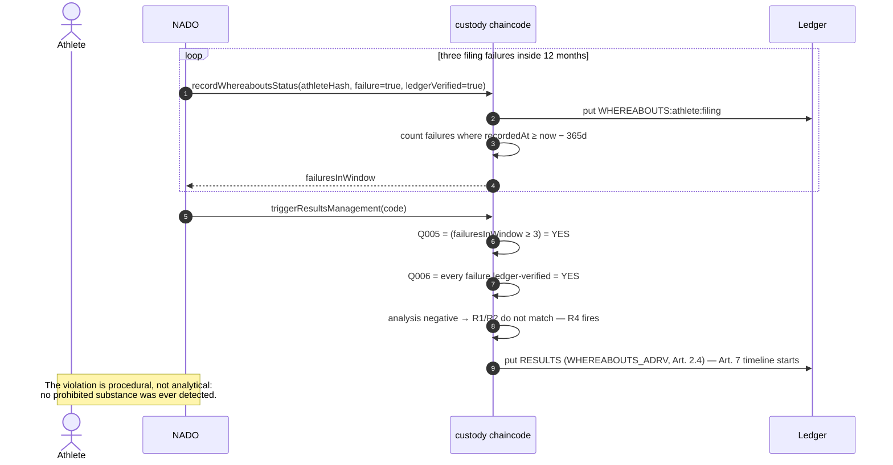

[PNG](diagrams/S5-whereabouts-adrv.png) &middot; rendered at 3x for print use

**Observed on the network**

> WHEREABOUTS_ADRV (R4_WHEREABOUTS_ADRV) with a negative analysis — the violation is procedural, not analytical

<details><summary>Executed steps</summary>

| Actor | Action | Outcome |
| --- | --- | --- |
| NADO | recordWhereaboutsStatus #1 (Art. 2.4) | failures in rolling 12-month window: 0 |
| NADO | recordWhereaboutsStatus #2 (Art. 2.4) | failures in rolling 12-month window: 1 |
| NADO | recordWhereaboutsStatus #3 (Art. 2.4) | failures in rolling 12-month window: 2 |
| Laboratory | recordSampleAnalysisResult | negative — no analytical finding |
| NADO | triggerResultsManagement (Art. 7.1) | Q005 ∧ Q006 → WHEREABOUTS_ADRV |

</details>

---

## S6 — Athlete Biological Passport anomaly escalates to the expert panel

**Regulation:** ABP / GDPR Art. 22  
**Decision-table rule:** `R3_ABP_ALERT_INITIATED`  
**Status:** executed and asserted

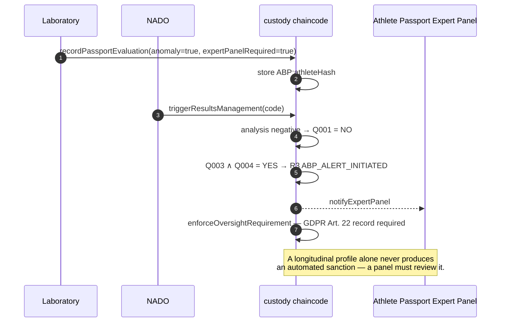

[PNG](diagrams/S6-abp-alert-expert-panel.png) &middot; rendered at 3x for print use

**Observed on the network**

> ABP_ALERT_INITIATED (R3_ABP_ALERT_INITIATED); humanOversightRequired=true

<details><summary>Executed steps</summary>

| Actor | Action | Outcome |
| --- | --- | --- |
| Laboratory | recordPassportEvaluation | longitudinal anomaly flagged, expert panel required |
| NADO / Lab | custody chain completed, analysis negative | no adverse analytical finding |
| NADO | triggerResultsManagement (Art. 7.1) | Q003 ∧ Q004 → ABP_ALERT_INITIATED |
| System → Expert Panel | notifyExpertPanel + enforceOversightRequirement | GDPR Art. 22 oversight record required |

</details>

---

## S7 — Insider acting alone cannot alter committed results-management state

**Regulation:** §4.1 threat model — insider collusion across CA boundaries  
**Status:** executed and asserted

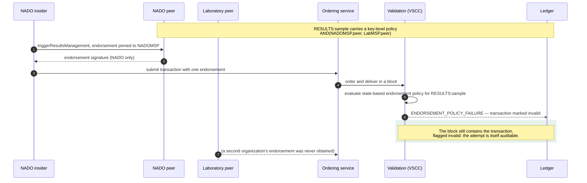

[PNG](diagrams/S7-insider-endorsement-blocked.png) &middot; rendered at 3x for print use

**Observed on the network**

> rejected with HTTP 400: transaction rejected

<details><summary>Executed steps</summary>

| Actor | Action | Outcome |
| --- | --- | --- |
| NADO + Lab | triggerResultsManagement (Art. 7.1) | AAF_CONFIRMED; results key bound to AND(NADOMSP, LabMSP) |
| NADO acting alone | triggerResultsManagement, endorsement pinned to NADOMSP | rejected — HTTP 400 |

</details>

---

## S8 — Career-affecting decision blocked until a named human upholds it

**Regulation:** WADA Art. 7.9 / GDPR Art. 22  
**Status:** executed and asserted

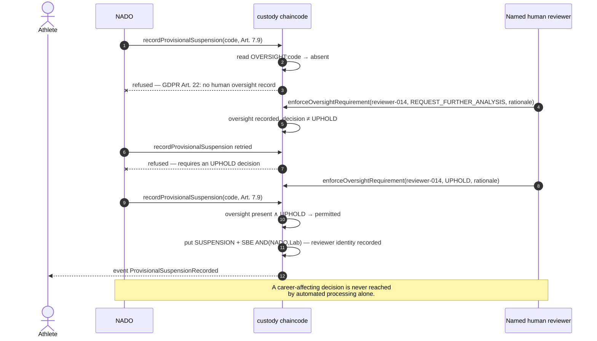

[PNG](diagrams/S8-article22-oversight-gate.png) &middot; rendered at 3x for print use

**Observed on the network**

> refused without oversight (HTTP 403); refused after REQUEST_FURTHER_ANALYSIS (HTTP 400); permitted after UPHOLD (HTTP 201)

<details><summary>Executed steps</summary>

| Actor | Action | Outcome |
| --- | --- | --- |
| NADO | results management completed | AAF confirmed |
| NADO | recordProvisionalSuspension (Art. 7.9) | refused — HTTP 403, GDPR Art. 22 |
| Human reviewer | enforceOversightRequirement → REQUEST_FURTHER_ANALYSIS | oversight recorded, finding not upheld |
| NADO | recordProvisionalSuspension retried | still refused — HTTP 400 |
| Human reviewer → NADO | oversight UPHOLD, then suspension | permitted — HTTP 201 |

</details>

---

## S9 — Purpose limitation releases two of six categories to an authorized researcher

**Regulation:** GDPR Art. 5(1)(c), 7, 9, 25 — §3.5 worked scenario  
**Status:** executed and asserted

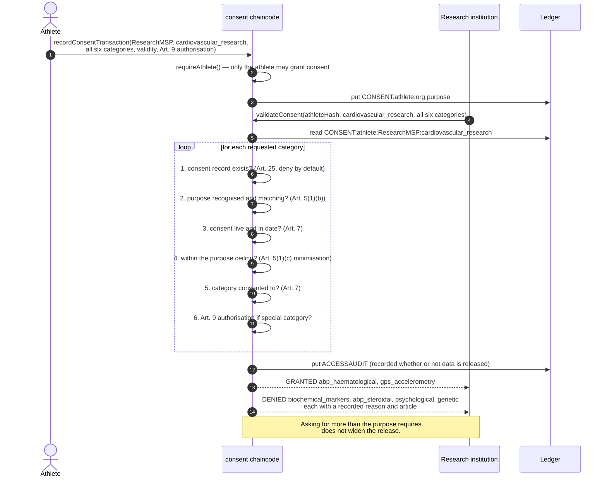

[PNG](diagrams/S9-purpose-limited-abac.png) &middot; rendered at 3x for print use

**Observed on the network**

> granted [abp_haematological, gps_accelerometry]; denied [abp_steroidal, biochemical_markers, genetic, psychological]

<details><summary>Executed steps</summary>

| Actor | Action | Outcome |
| --- | --- | --- |
| Athlete | recordConsentTransaction (GDPR Art. 7) | consent granted across all six categories |
| Researcher | validateConsent — requests all six categories | granted 2, denied 4 |
| System | access audit written | every decision recorded with a reason, granted or not |

</details>

---

## S10 — Consent withdrawal takes effect immediately

**Regulation:** GDPR Art. 7(3)  
**Status:** executed and asserted

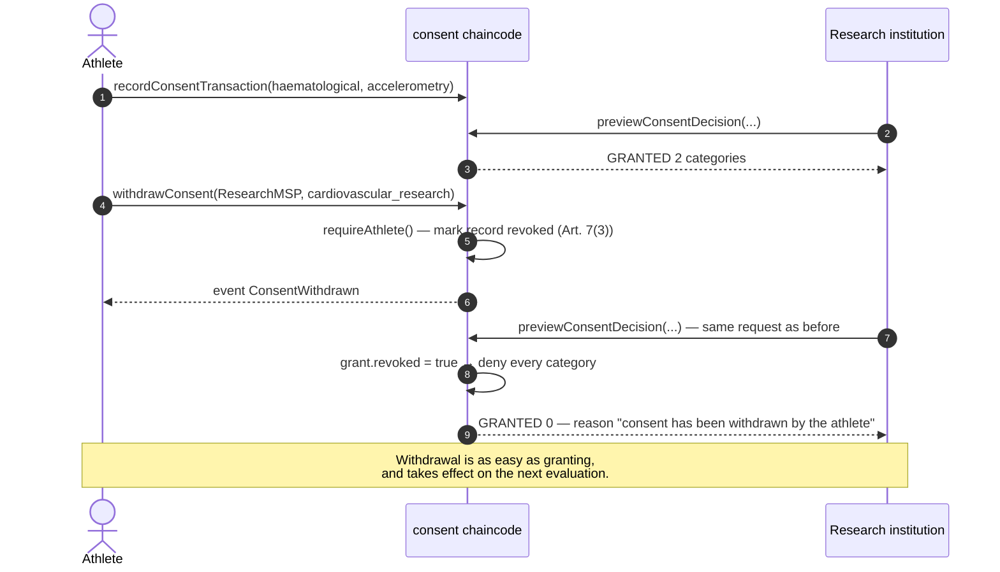

[PNG](diagrams/S10-consent-withdrawal.png) &middot; rendered at 3x for print use

**Observed on the network**

> 2 categories before withdrawal, 0 after

<details><summary>Executed steps</summary>

| Actor | Action | Outcome |
| --- | --- | --- |
| Athlete → Researcher | consent granted, access evaluated | granted 2 categories |
| Athlete | withdrawConsent (Art. 7(3)) | consent record marked revoked on-chain |
| Researcher | access re-evaluated | granted 0; reason: consent has been withdrawn by the athlete |

</details>

---

## S11 — Off-chain storage, key revocation with 2-of-3 recovery, then irreversible erasure

**Regulation:** GDPR Art. 17  
**Status:** executed and asserted

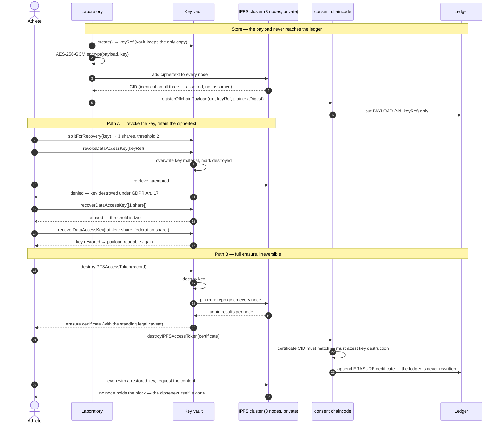

[PNG](diagrams/S11-erasure-and-recovery.png) &middot; rendered at 3x for print use

**Observed on the network**

> stored on 3 nodes; IPFS holds ciphertext only (true); after revokeDataAccessKey access denied (true) and 1 share insufficient (true) but 2 of 3 restored it (true); after destroyIPFSAccessToken unreadable (true) and content gone from every node (true)

<details><summary>Executed steps</summary>

| Actor | Action | Outcome |
| --- | --- | --- |
| Laboratory | AES-256-GCM encrypt → IPFS add (3 nodes) | CID bafkreiabjiexvxb…, pinned on 3 nodes |
| Laboratory → Ledger | registerOffchainPayload | only {cid, keyRef} on-chain; payload never touches the ledger |
| Authorized reader | retrieve + decrypt | round-trip intact: true |
| Unauthorized reader | read raw IPFS content | ciphertext only, no plaintext markers: true |
| Athlete / physician / federation | Shamir 2-of-3 split of the data-encryption key | 3 shares issued, threshold 2 |
| Athlete | revokeDataAccessKey (Art. 17, key only) | key destroyed; ciphertext still pinned |
| Any reader | retrieve attempted | denied: true |
| Physician alone | recoverDataAccessKey with 1 share | refused: true |
| Athlete + federation (2 of 3) | recoverDataAccessKey | access restored: true |
| Athlete | destroyIPFSAccessToken (Art. 17, full) | key destroyed; unpinned on 3 nodes |
| Athlete → Ledger | record erasure certificate | ledger appended, never rewritten |
| Any reader | retrieve attempted after full erasure | unrecoverable: true |
| Athlete + physician (2 of 3) | key recovered, content requested | content no longer held by any node: true |

</details>

---

## S12 — Results are confidential during results management

**Regulation:** WADA Art. 14.1  
**Status:** executed and asserted

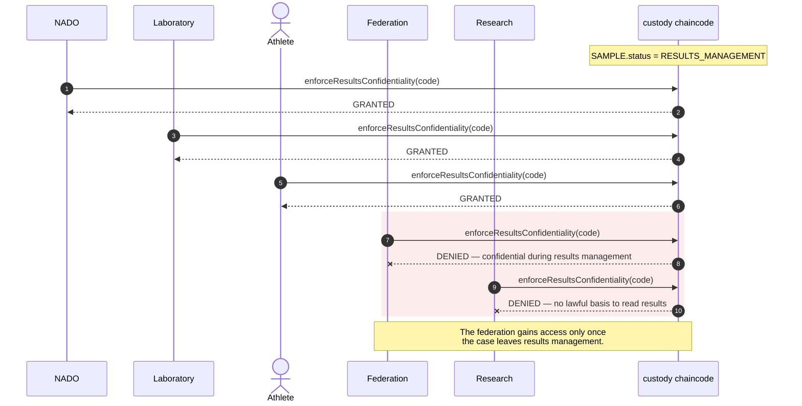

[PNG](diagrams/S12-results-confidentiality.png) &middot; rendered at 3x for print use

**Observed on the network**

> nado:200  lab:200  athlete:200  federation:403  research:403

<details><summary>Executed steps</summary>

| Actor | Action | Outcome |
| --- | --- | --- |
| NADO | case enters results management | confidentiality gate active |
| NADO | enforceResultsConfidentiality (Art. 14.1) | HTTP 200 |
| LAB | enforceResultsConfidentiality (Art. 14.1) | HTTP 200 |
| ATHLETE | enforceResultsConfidentiality (Art. 14.1) | HTTP 200 |
| FEDERATION | enforceResultsConfidentiality (Art. 14.1) | HTTP 403 |
| RESEARCH | enforceResultsConfidentiality (Art. 14.1) | HTTP 403 |

</details>

---

## S13 — Late custody handover raises an exception and invalidates the process

**Regulation:** WADA Art. 5.4  
**Decision-table rule:** `R5_PROCESS_INVALIDATED`  
**Status:** executed and asserted

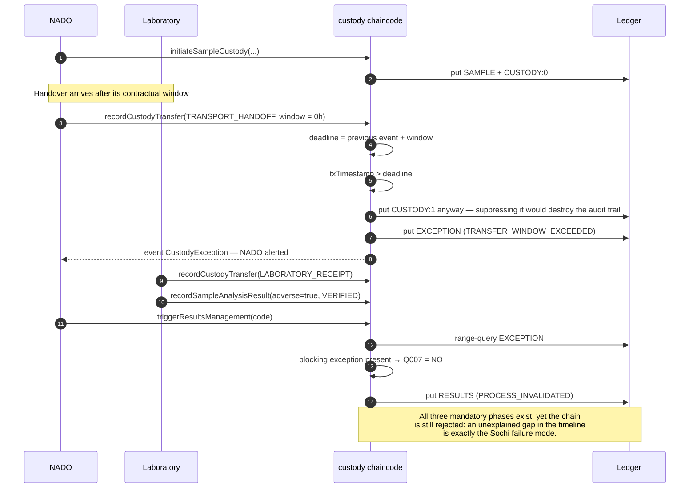

[PNG](diagrams/S13-late-handover-exception.png) &middot; rendered at 3x for print use

**Observed on the network**

> PROCESS_INVALIDATED (R5_PROCESS_INVALIDATED); mandatoryCustodyStepVerified=false

<details><summary>Executed steps</summary>

| Actor | Action | Outcome |
| --- | --- | --- |
| NADO | initiateSampleCustody | custody opened |
| NADO → Lab | recordCustodyTransfer past its window | transfer written; exception raised; NADO alerted |
| NADO | triggerResultsManagement | blocking exception → Q007 = NO → PROCESS_INVALIDATED |

</details>

---

## Platform transaction flow

The six-phase Hyperledger Fabric flow every scenario above runs through. This
replaces the schematic version of the manuscript's Figure 5 with the deployed
configuration, including the key-level endorsement check that the §4.1 mitigation
depends on.

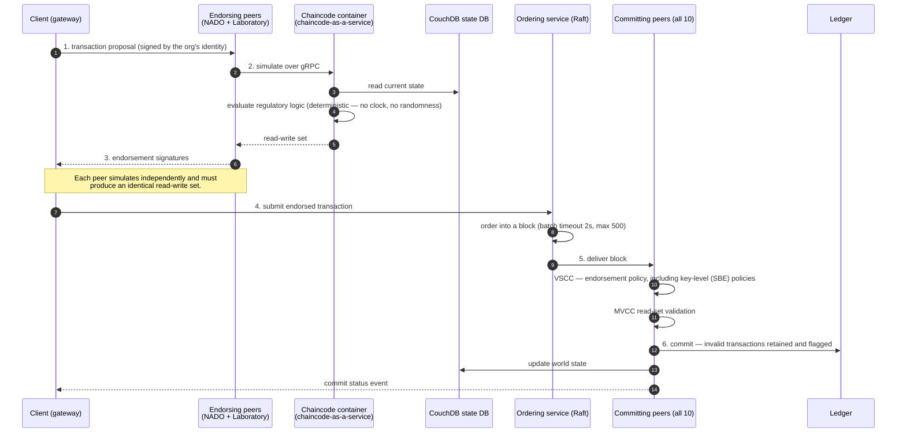

[PNG](diagrams/F1-fabric-transaction-flow.png)

Two properties of this flow are load-bearing for the framework:

- **Determinism.** Every endorsing peer simulates independently and the read-write
  sets must match, which is why the chaincode reads time from the transaction
  timestamp rather than a local clock.
- **Invalid transactions are retained.** A rejected transaction stays in the block,
  flagged invalid, so an attempt to write results-management state with insufficient
  endorsement (S7) is itself part of the audit trail.

